# RailLanka Frontend

**A role-based web client for a full-stack railway e-ticket reservation and management platform for Sri Lanka.**


RailLanka lets passengers search train journeys, choose a ticket class, pay online and receive a QR e-ticket, while administrators manage the railway network and ticket inspectors validate tickets by scanning. This repository contains the **React + TypeScript single-page application**. It talks to the [RailLanka Backend](https://github.com/RayanKavishka/RailLanka-Backend) over a REST API.

| | |
|---|---|
| **Live application** | [raillanka.vercel.app](https://raillanka.vercel.app) |
| **Backend repository** | [RayanKavishka/RailLanka-Backend](https://github.com/RayanKavishka/RailLanka-Backend) |
| **Architecture** | MERN stack (this repo is the "R" in MERN, written in TypeScript) |
| **User roles** | Passenger, Administrator, Ticket Inspector |

---

## Table of contents

- [Overview](#overview)
- [Application screenshots](#application-screenshots)
- [Features](#features)
- [Technology stack](#technology-stack)
- [Architecture and project structure](#architecture-and-project-structure)
- [Installation and local development](#installation-and-local-development)
- [Environment variables](#environment-variables)
- [API integration](#api-integration)
- [Docker](#docker)
- [CI/CD](#cicd)
- [Deployment](#deployment)
- [Known limitations and roadmap](#known-limitations-and-roadmap)
- [Author and contribution](#author-and-contribution)

---

## Overview

The frontend is a single-page application with **three separate user experiences** behind one login, selected by the account's role:

- **Passengers** search journeys by station and date, pick ticket classes, pay through the PayHere gateway, and keep their QR e-tickets in one place. A passenger-only AI assistant answers questions about stations, routes and the passenger's own tickets.
- **Administrators** manage stations (with an interactive map), routes and timetables, administrator and inspector accounts, and review payment records.
- **Ticket inspectors** scan a passenger's QR e-ticket with the device camera (or an uploaded image) and see whether it is valid.

The UI is built with Tailwind CSS utility classes and uses responsive breakpoints so the same pages work on mobile, tablet and desktop widths.

---

## Application screenshots

> Screenshots were captured from the production deployment ([raillanka.vercel.app](https://raillanka.vercel.app)) and from a local development build. The payment pages shown are the **PayHere sandbox** (test environment). Personal contact details and live QR codes have been blurred.

### Landing page and authentication

<table>
  <tr>
    <td width="50%">
      <a href="docs/screenshots/auth/01-landing-page.png">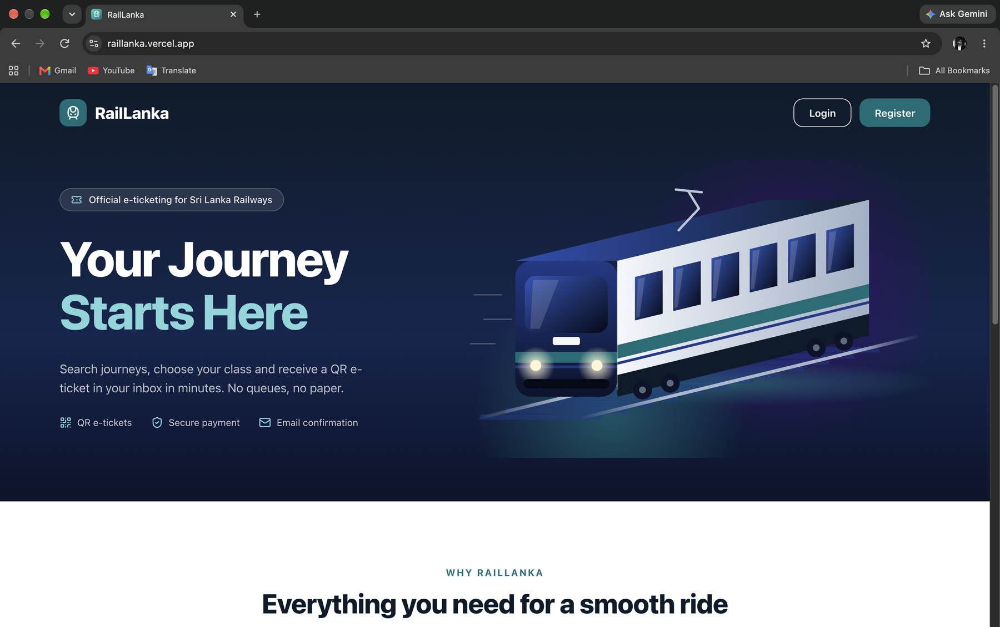</a>
      <br><sub><b>Landing page.</b> Public entry point with Login and Register actions.</sub>
    </td>
    <td width="50%">
      <a href="docs/screenshots/auth/02-login.png">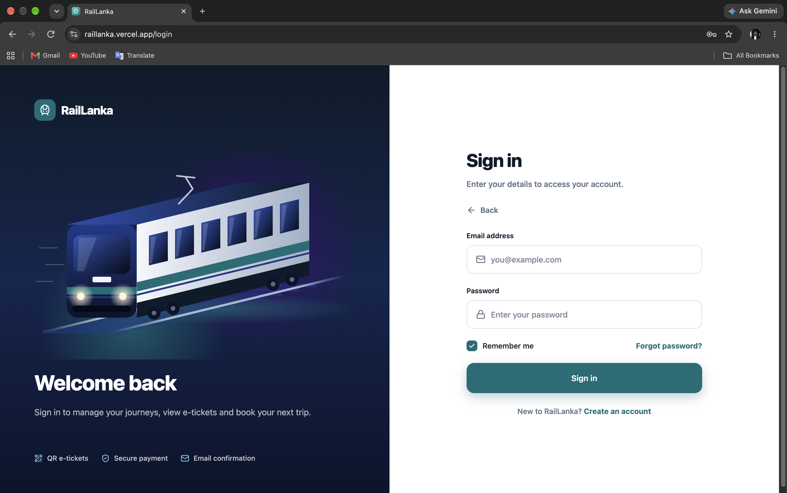</a>
      <br><sub><b>Sign in.</b> Email and password login with a "Forgot password?" entry point.</sub>
    </td>
  </tr>
  <tr>
    <td width="50%">
      <a href="docs/screenshots/auth/03-register.png">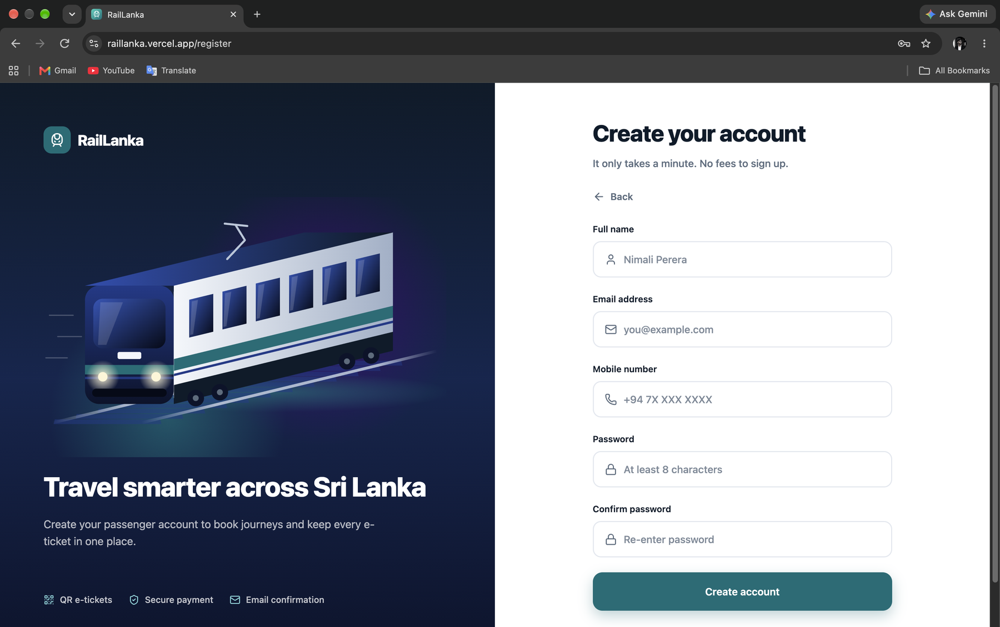</a>
      <br><sub><b>Passenger registration.</b> Full name, email, mobile number and password confirmation.</sub>
    </td>
    <td width="50%">
      <a href="docs/screenshots/auth/04-forgot-password.png">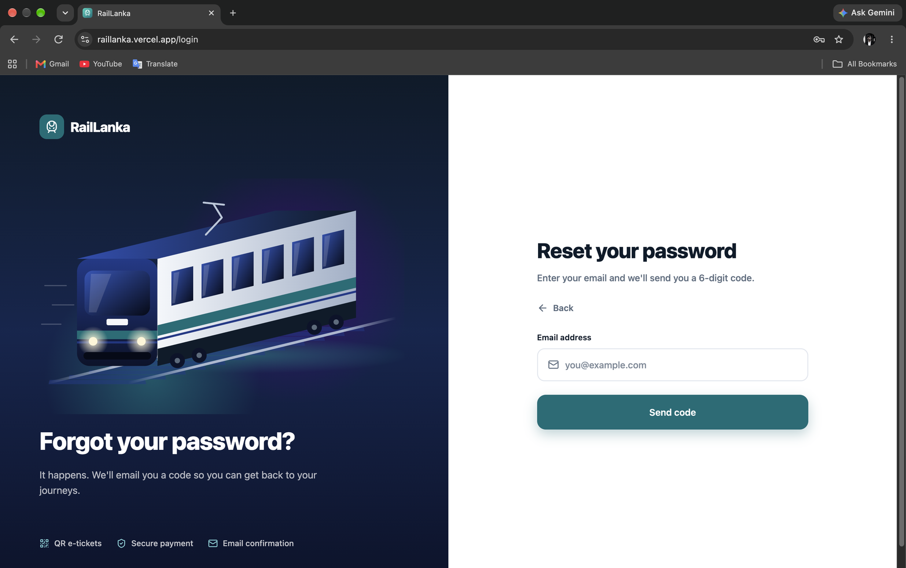</a>
      <br><sub><b>Password reset.</b> Step 1 of 3: request a 6-digit code by email.</sub>
    </td>
  </tr>
</table>

### Passenger journey: search, book, pay, travel

<table>
  <tr>
    <td width="50%">
      <a href="docs/screenshots/passenger/01-home-journey-search.png">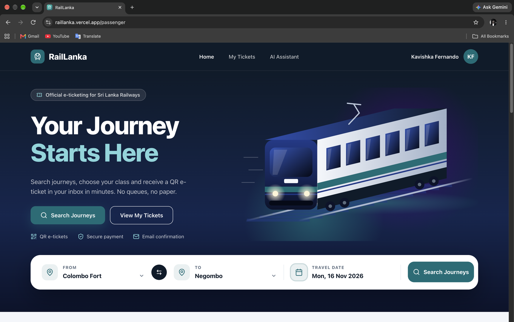</a>
      <br><sub><b>Journey search.</b> From / To stations (with swap) and travel date.</sub>
    </td>
    <td width="50%">
      <a href="docs/screenshots/passenger/02-available-journeys.png">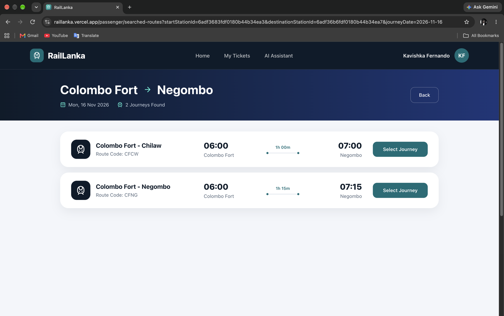</a>
      <br><sub><b>Available journeys.</b> Matching routes with departure, arrival and duration.</sub>
    </td>
  </tr>
  <tr>
    <td width="50%">
      <a href="docs/screenshots/passenger/03-select-passengers.png">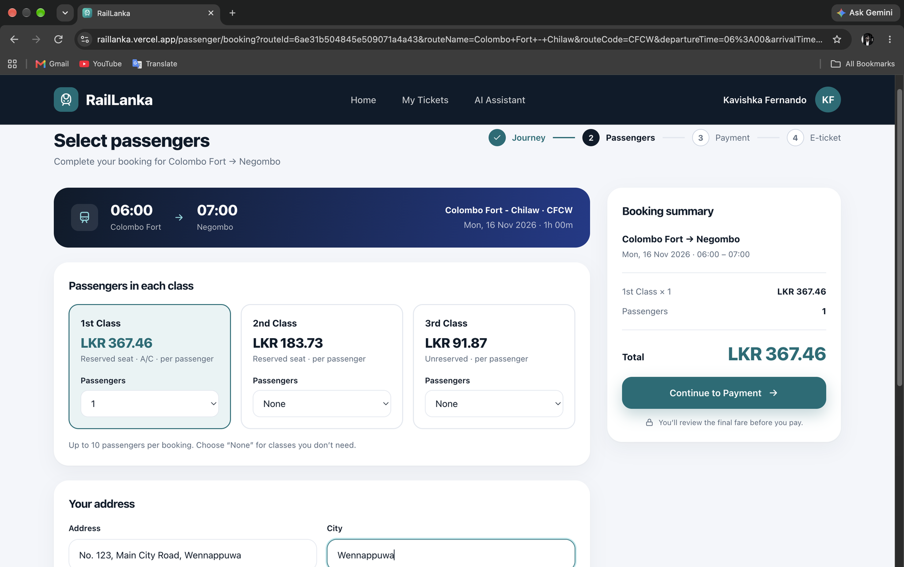</a>
      <br><sub><b>Select passengers.</b> Per-class prices, passenger count per class, address and live booking summary.</sub>
    </td>
    <td width="50%">
      <a href="docs/screenshots/passenger/04-secure-payment.png">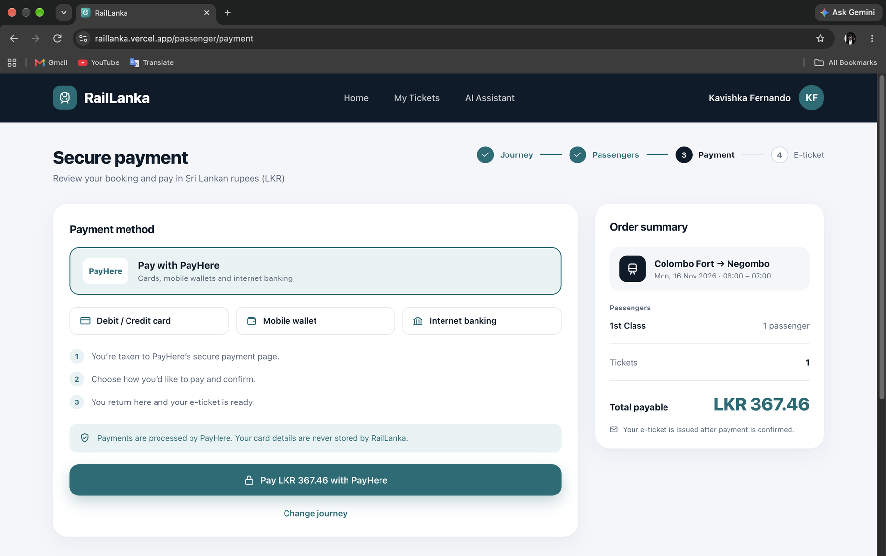</a>
      <br><sub><b>Secure payment.</b> Order summary and hand-off to PayHere (amounts in LKR).</sub>
    </td>
  </tr>
  <tr>
    <td width="50%">
      <a href="docs/screenshots/passenger/05-payhere-sandbox-checkout.png">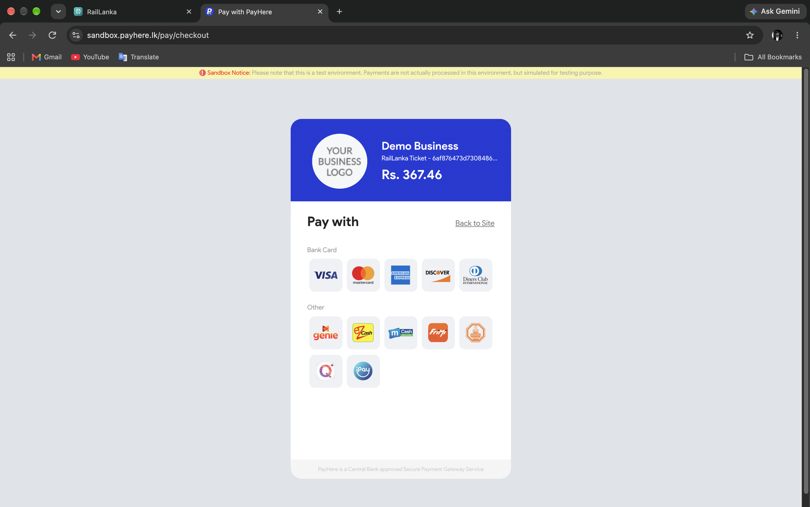</a>
      <br><sub><b>PayHere checkout (sandbox).</b> Hosted payment page; card details never touch RailLanka.</sub>
    </td>
    <td width="50%">
      <a href="docs/screenshots/passenger/06-payhere-payment-approved.png">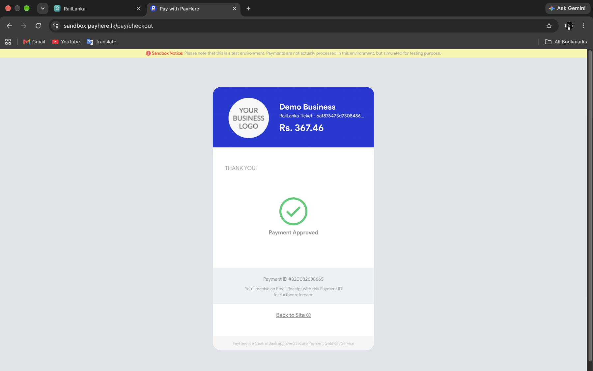</a>
      <br><sub><b>Payment approved (sandbox).</b> The user returns to RailLanka from here.</sub>
    </td>
  </tr>
  <tr>
    <td width="50%">
      <a href="docs/screenshots/passenger/07-booking-confirmed-qr-ticket.png">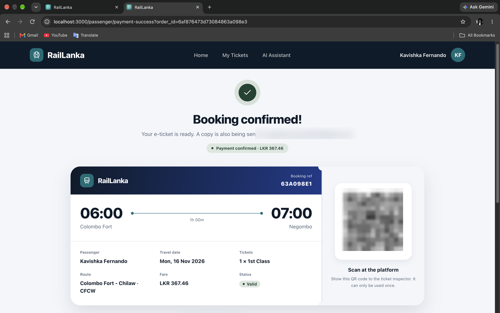</a>
      <br><sub><b>Booking confirmed.</b> E-ticket with journey details, booking reference and QR code (blurred here).</sub>
    </td>
    <td width="50%">
      <a href="docs/screenshots/passenger/08-my-tickets.png">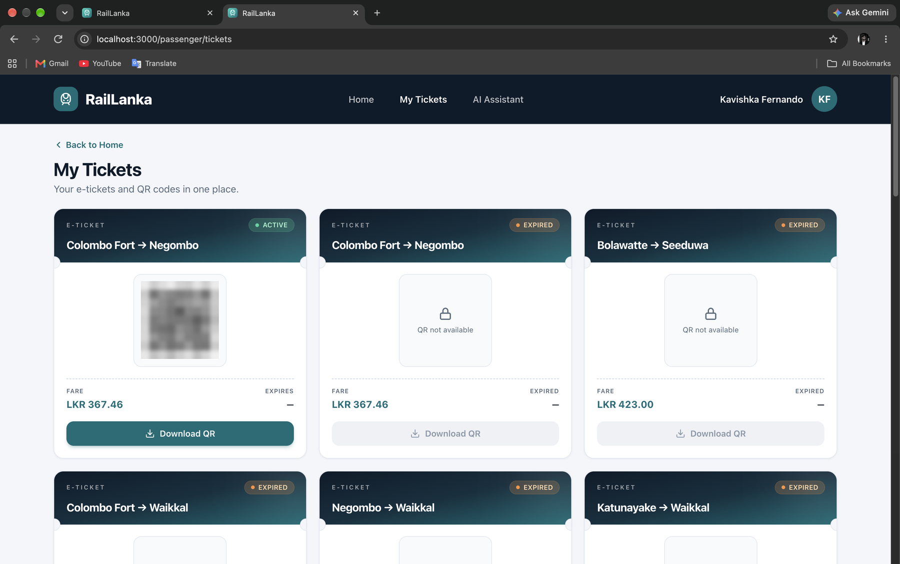</a>
      <br><sub><b>My Tickets.</b> Ticket history with Active / Expired status and QR download.</sub>
    </td>
  </tr>
  <tr>
    <td width="50%">
      <a href="docs/screenshots/passenger/09-booking-confirmation-email.png">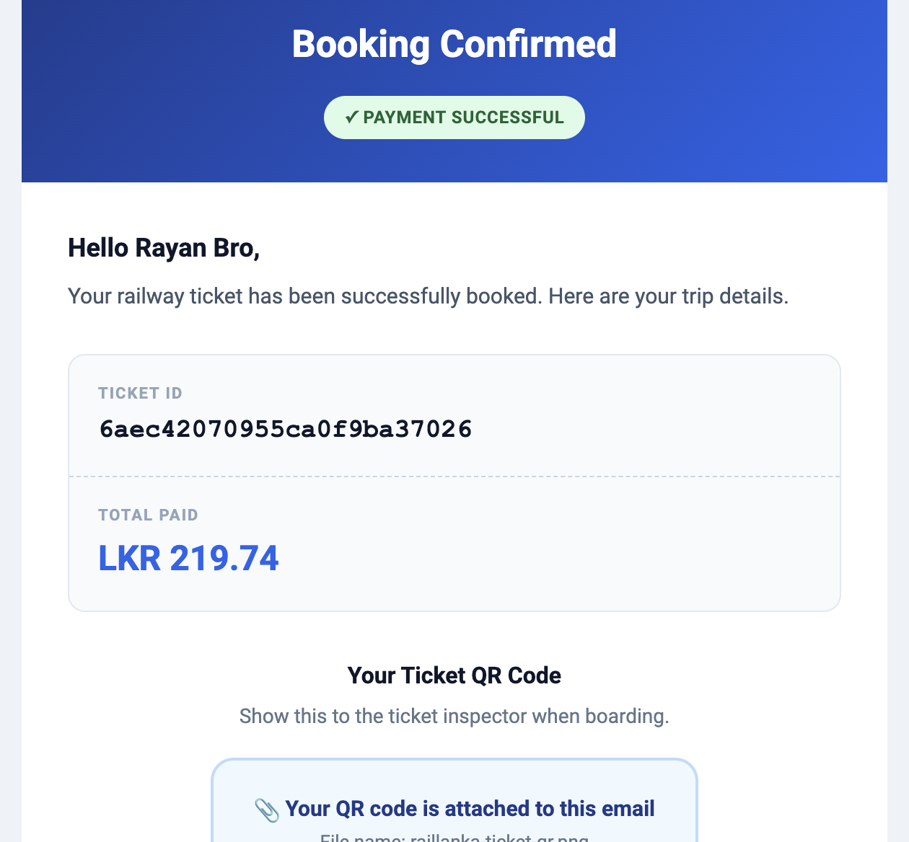</a>
      <br><sub><b>Confirmation email.</b> Sent by the backend after payment is confirmed; the QR is attached.</sub>
    </td>
    <td width="50%">
      <a href="docs/screenshots/passenger/10-ai-assistant.png">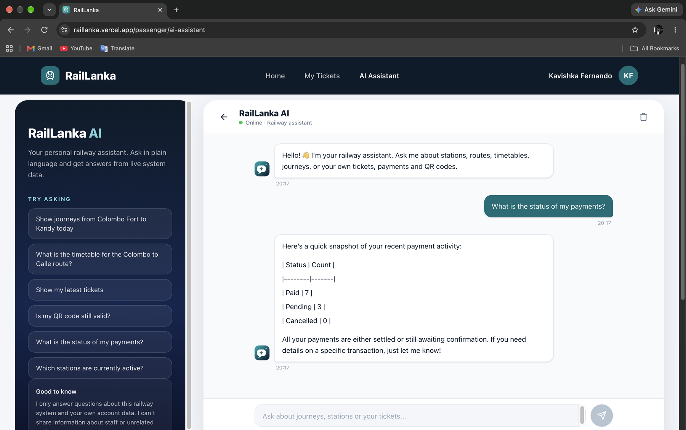</a>
      <br><sub><b>AI assistant.</b> Natural-language questions about stations, routes and the passenger's own tickets.</sub>
    </td>
  </tr>
  <tr>
    <td width="50%">
      <a href="docs/screenshots/passenger/11-profile.png">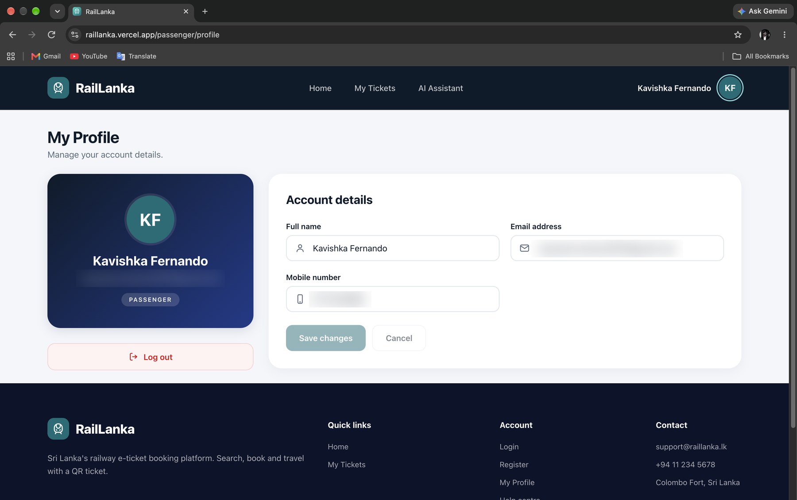</a>
      <br><sub><b>Profile.</b> View and edit account details; log out.</sub>
    </td>
    <td width="50%"></td>
  </tr>
</table>

### Administrator console

<table>
  <tr>
    <td width="50%">
      <a href="docs/screenshots/admin/01-dashboard.png">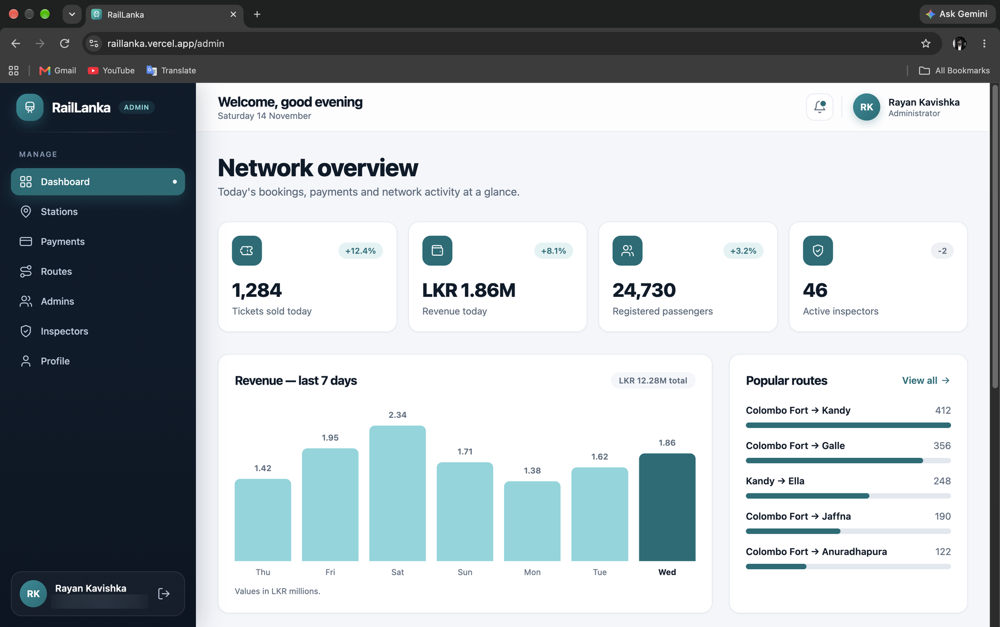</a>
      <br><sub><b>Dashboard.</b> Layout built with <b>static sample data</b>; not yet connected to the API (see <a href="#known-limitations-and-roadmap">limitations</a>).</sub>
    </td>
    <td width="50%">
      <a href="docs/screenshots/admin/02-stations-add-form.png">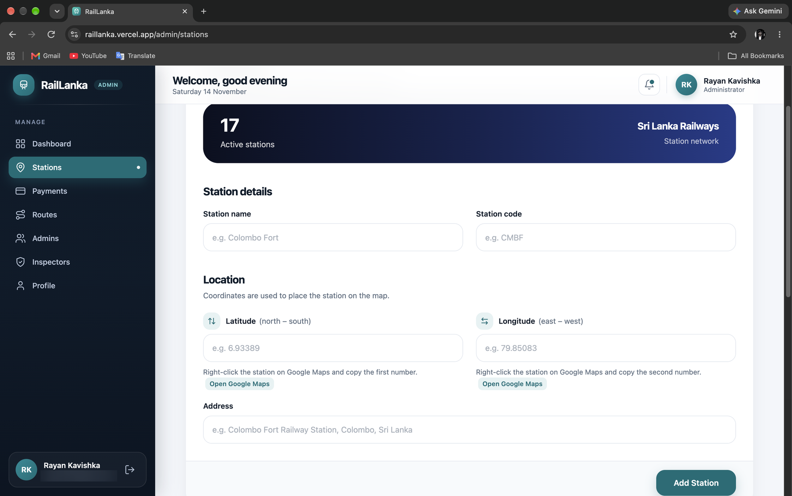</a>
      <br><sub><b>Stations: add.</b> Station details and coordinates (with Google Maps shortcuts).</sub>
    </td>
  </tr>
  <tr>
    <td width="50%">
      <a href="docs/screenshots/admin/03-stations-map.png">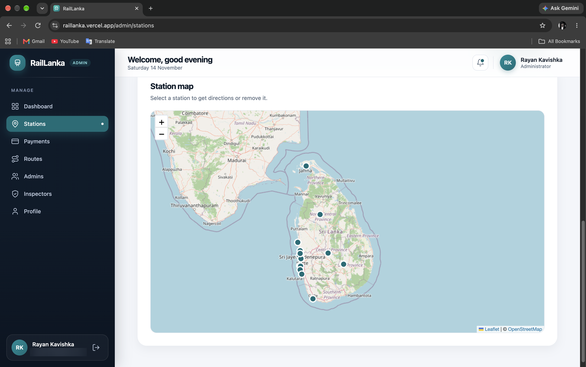</a>
      <br><sub><b>Stations: map.</b> Leaflet map with a popup per station to get directions or remove it.</sub>
    </td>
    <td width="50%">
      <a href="docs/screenshots/admin/04-payments.png">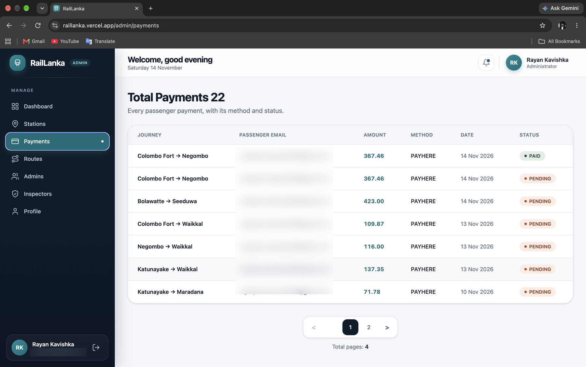</a>
      <br><sub><b>Payments.</b> Paginated payment records with Paid / Pending status (emails blurred).</sub>
    </td>
  </tr>
  <tr>
    <td width="50%">
      <a href="docs/screenshots/admin/05-routes.png">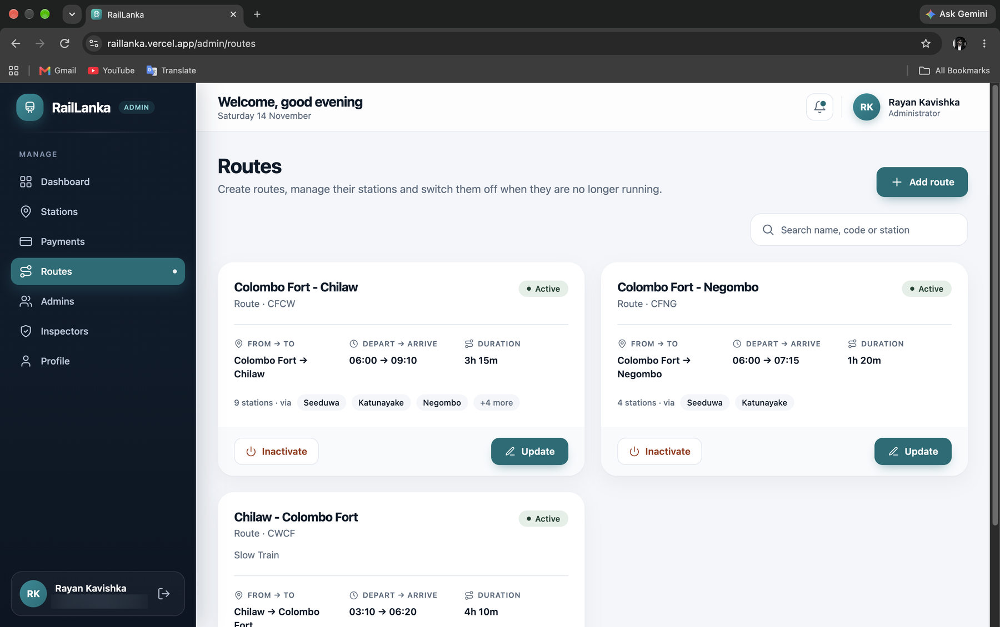</a>
      <br><sub><b>Routes.</b> Search, add, update and inactivate routes and their timetables.</sub>
    </td>
    <td width="50%">
      <a href="docs/screenshots/admin/06-admins.png">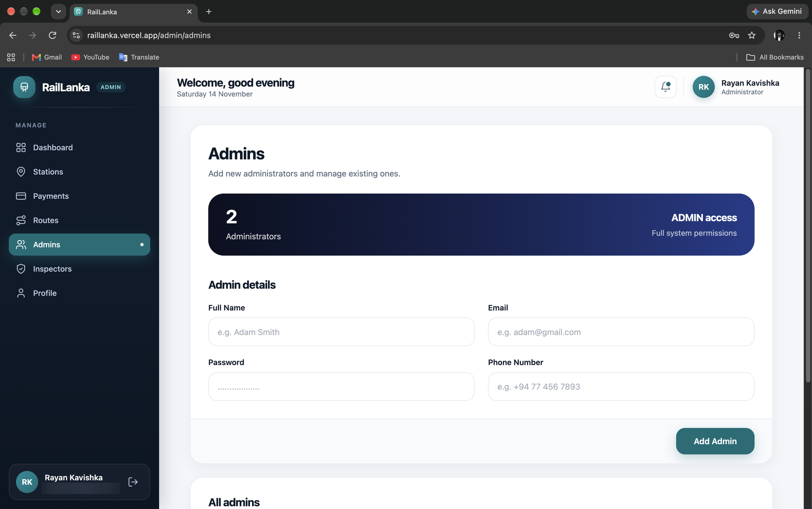</a>
      <br><sub><b>Administrators.</b> Create and manage administrator accounts.</sub>
    </td>
  </tr>
  <tr>
    <td width="50%">
      <a href="docs/screenshots/admin/07-inspectors.png">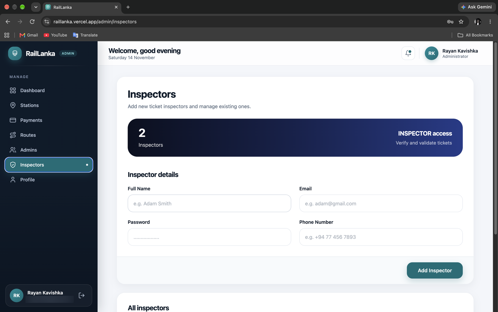</a>
      <br><sub><b>Inspectors.</b> Create and manage ticket inspector accounts.</sub>
    </td>
    <td width="50%"></td>
  </tr>
</table>

### Ticket inspector

<table>
  <tr>
    <td width="50%">
      <a href="docs/screenshots/inspector/01-dashboard.png">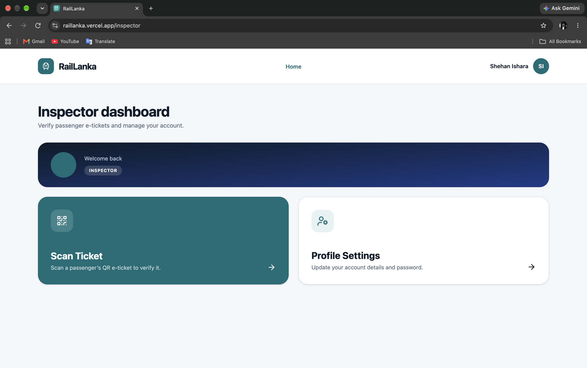</a>
      <br><sub><b>Inspector dashboard.</b> Quick access to scanning and profile settings.</sub>
    </td>
    <td width="50%">
      <a href="docs/screenshots/inspector/02-scan-ticket.png">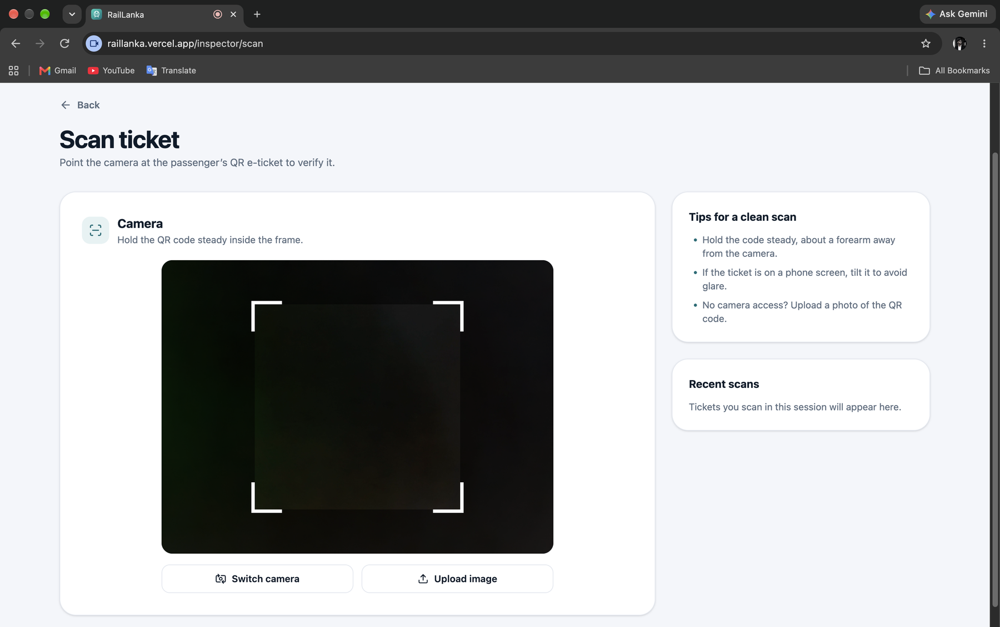</a>
      <br><sub><b>Scan ticket.</b> Camera scanning with camera switching, or upload an image of the QR code.</sub>
    </td>
  </tr>
</table>

---

## Features

### Authentication and access control

- **Register / sign in** with email and password. Registration creates a passenger account (the client sends the `PASSENGER` role).
- **Forgot-password flow** in three steps on the login page: request a code by email, enter the **6-digit OTP** (with a resend cooldown timer), then set a new password (minimum 8 characters, confirmation required).
- **Role-based routing.** The app has three protected areas (`/admin`, `/passenger`, `/inspector`). `RequireAuth` blocks users whose active role does not match, and signed-in users who open a public page are redirected to their own home.
- **Silent token refresh.** An Axios interceptor refreshes an expired access token with the stored refresh token and replays the failed request.

### Passenger experience

1. **Search** a journey by *From*, *To* and travel date (past dates are disabled; stations can be swapped).
2. **Choose a journey** from the matching routes returned by the API.
3. **Select passengers.** Prices for first, second and third class are loaded from the backend for the chosen station pair; the passenger picks a count per class (up to **10 per booking**) and enters an address and city.
4. **Pay.** The booking request returns PayHere checkout data; the app posts it to PayHere's hosted page.
5. **Confirmation.** After PayHere redirects back, the confirmation page **polls the backend every 3 seconds (up to 20 times)** until the payment is `PAID` and the QR code is ready. A separate view handles cancelled payments.
6. **My Tickets** lists every ticket with its QR status (`ACTIVE`, `USED`, `EXPIRED`) and a QR download button.
7. **AI assistant** chat with suggested questions and a "clear conversation" action.
8. **Profile** page to update name, email and mobile number.

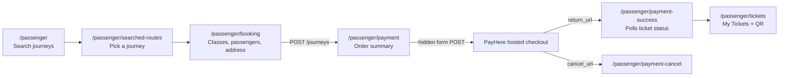

### Administrator experience

| Area | What the UI supports |
|---|---|
| **Stations** | Add a station (name, code, latitude/longitude, address); view all active stations on a Leaflet map; open a station in Google Maps; remove (deactivate) a station. |
| **Routes** | Create and update routes with an ordered list of stops and arrival/departure times; search routes by name, code or station; inactivate a route. |
| **Payments** | Paginated payment records (7 per page) showing journey, passenger email, amount, method, date and status. |
| **Administrators** | Add, edit and deactivate administrator accounts. |
| **Inspectors** | Add, edit and deactivate ticket inspector accounts. |
| **Dashboard** | Overview layout (cards, 7-day revenue chart, popular routes). Currently renders static sample data. |

### Ticket inspector experience

- Live **camera scanning** using `html5-qrcode`, with **Switch camera** and **Upload image** fallbacks.
- The decoded QR token is verified through the backend; the page shows the result and keeps a **recent scans** list for the session.

---

## Technology stack

| Category | Technology | Notes |
|---|---|---|
| **Core** | TypeScript 6, JavaScript (ES2023 target) | Bundler-mode TypeScript configuration with unused-code checks (`noUnusedLocals`, `noUnusedParameters`) |
| **Frontend framework** | React 19 | Function components and hooks |
| **Build tool** | Vite 8 with `@vitejs/plugin-react` | Dev server on port `3000` |
| **Styling** | Tailwind CSS 4 via `@tailwindcss/vite` | Utility-first, responsive breakpoints |
| **Routing** | React Router DOM 7 | Nested routes, layout routes, role guards |
| **State management** | React Context API + component state | `AuthContext` holds the user and active role; no external state library |
| **API communication** | Axios 1.x | Shared instance with request/response interceptors |
| **UI components and icons** | Custom components, `lucide-react` | Plus inline SVG illustrations |
| **Maps** | Leaflet 1.9, `react-leaflet` 5 | Station map (OpenStreetMap tiles) |
| **QR scanning** | `html5-qrcode` | Camera and image-file scanning for inspectors |
| **Notifications** | Sonner | Toast messages for success and error states |
| **Linting** | ESLint 10, `typescript-eslint`, `eslint-plugin-react-hooks`, `eslint-plugin-react-refresh` | `npm run lint` |
| **Testing** | None implemented | See [roadmap](#known-limitations-and-roadmap) |
| **Hosting** | Vercel | SPA rewrite configured in `vercel.json` |

---

## Architecture and project structure

The app is a client-rendered SPA. **Pages** compose UI and local state, **services** wrap every HTTP call, and a single **Axios instance** handles the base URL, bearer token and token refresh.

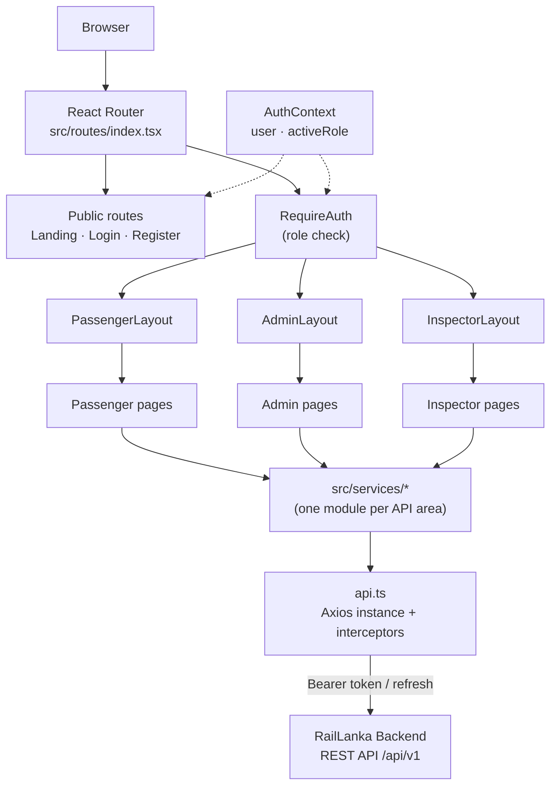

### Directory tree

```text
RailLanka-Frontend/
├── docs/
│   └── screenshots/            # README images (auth, passenger, admin, inspector)
├── public/                     # favicon and static icons
├── src/
│   ├── assets/                 # images bundled with the app
│   ├── components/
│   │   ├── auth/               # TrainIllustration
│   │   ├── passenger/          # JourneyCard
│   │   ├── ui/                 # Loading, AiLogo
│   │   └── ScrollToTop.tsx
│   ├── context/AuthContext.tsx # current user + active role
│   ├── hooks/useAuth.ts        # typed access to AuthContext
│   ├── layouts/                # Admin, Passenger, Inspector and Auth layouts
│   ├── pages/
│   │   ├── admin/              # Dashboard, Stations, Routes, Payments, Admins, Inspectors
│   │   ├── auth/               # Login (incl. password reset), Register
│   │   ├── common/             # UserProfilePage (shared by all roles)
│   │   ├── inspector/          # Dashboard, ScanPage
│   │   ├── passenger/          # Dashboard, searched routes, booking, payment, tickets, AI chat
│   │   ├── Landing.tsx
│   │   └── NotFound.tsx
│   ├── routes/                 # Router, RequireAuth, PublicRoute
│   ├── services/               # Axios instance + API modules
│   ├── App.tsx                 # AuthProvider + router
│   ├── main.tsx                # entry point
│   └── index.css               # Tailwind entry
├── eslint.config.js
├── index.html
├── package.json
├── tsconfig*.json
├── vercel.json                 # SPA rewrite for client-side routing
└── vite.config.ts
```

### Folder responsibilities

| Folder | Responsibility |
|---|---|
| `src/routes` | Route table, `RequireAuth` (authentication + role guard) and `PublicRoute` (redirects signed-in users away from login/register). |
| `src/layouts` | Role-specific shells (navigation, footer/sidebar) rendered around nested pages. |
| `src/pages` | Screens, grouped by role. Booking helpers shared by the passenger flow live in `BookingShared.tsx` (types, formatting, session storage for the in-progress booking). |
| `src/services` | `api.ts` plus one module per backend area: `authService`, `routeService`, `stationService`, `journeyService`, `paymentService`, `ticketService`, `qrService`, `userService`, `aiAgentService`. |
| `src/context` and `src/hooks` | Authentication state (`user`, `activeRole`, `isLoading`) loaded from `GET /auth/me` on startup. |
| `src/components` | Reusable pieces (loading screen, journey card, illustrations). |

### Route map

| Path | Access | Screen |
|---|---|---|
| `/`, `/login`, `/register` | Public (redirects if signed in) | Landing, sign in / password reset, registration |
| `/passenger` | `PASSENGER` | Journey search home |
| `/passenger/searched-routes` | `PASSENGER` | Available journeys |
| `/passenger/booking` | `PASSENGER` | Passenger selection |
| `/passenger/payment` | `PASSENGER` | Payment summary and PayHere hand-off |
| `/passenger/payment-success`, `/passenger/payment-cancel` | `PASSENGER` | Confirmation / cancelled |
| `/passenger/tickets` | `PASSENGER` | My Tickets |
| `/passenger/ai-assistant` | `PASSENGER` | AI assistant |
| `/admin`, `/admin/stations`, `/admin/routes`, `/admin/payments`, `/admin/admins`, `/admin/inspectors` | `ADMIN` | Administrator console |
| `/inspector`, `/inspector/scan` | `TICKET_INSPECTOR` | Inspector dashboard and scanner |
| `*/profile` | Each role under its own prefix | Profile page |

If a user holds several roles, the active role is chosen in this order: **Admin, then Ticket Inspector, then Passenger**.

---

## Installation and local development

### Prerequisites

- **Node.js 22 LTS** (the backend CI uses Node 22) and **npm**
- A running instance of the [RailLanka Backend](https://github.com/RayanKavishka/RailLanka-Backend) (default `http://localhost:5001`)

### 1. Clone the repository

```bash
git clone https://github.com/RayanKavishka/RailLanka-Frontend.git
cd RailLanka-Frontend
```

### 2. Install dependencies

```bash
npm install
```

### 3. Configure environment variables

Create a `.env` file in the project root (it is git-ignored):

```bash
echo "VITE_API_BASE_URL=http://localhost:5001/api/v1" > .env
```

See [Environment variables](#environment-variables) for details.

### 4. Start the development server

```bash
npm run dev
```

The app is served at **http://localhost:3000** (port set in `vite.config.ts`). The backend allows this origin through CORS.

### 5. Build for production

```bash
npm run build      # type-checks with tsc -b, then bundles with Vite into dist/
npm run preview    # serves the production build locally
```

### 6. Lint and tests

```bash
npm run lint       # ESLint
```

No automated test suite is implemented in this repository yet, and there is no `test` script.

### Available scripts

| Script | Command | Purpose |
|---|---|---|
| `npm run dev` | `vite` | Development server with hot reload |
| `npm run build` | `tsc -b && vite build` | Type-check and create the production bundle |
| `npm run lint` | `eslint .` | Lint the project |
| `npm run preview` | `vite preview` | Preview the production build |

---

## Environment variables

The frontend reads **one** environment variable. Vite exposes only variables prefixed with `VITE_`, and the value is **embedded at build time**, so changing it requires a rebuild or redeploy.

| Variable | Required | Used in | Description |
|---|---|---|---|
| `VITE_API_BASE_URL` | Yes | `src/services/api.ts` | Base URL of the backend REST API **including the `/api/v1` prefix**, for example `http://localhost:5001/api/v1`. Service modules append paths such as `/auth/login` to it. |

Example `.env` (create this file locally; never commit real values):

```bash
# Backend REST API base URL (include /api/v1)
VITE_API_BASE_URL=http://localhost:5001/api/v1
```

For production, set the same variable in the hosting dashboard to your deployed backend URL, for example `https://<your-backend-host>/api/v1`.

---

## API integration

### Base URL and structure

All requests go through a shared Axios instance (`src/services/api.ts`) whose `baseURL` is `VITE_API_BASE_URL`. The backend exposes a versioned REST API under `/api/v1`. Successful responses wrap data as `{ message, body }` (or `data` for the booking checkout payload), and errors return `{ message }`.

### Endpoints used by the frontend

| Area | Endpoints (relative to `/api/v1`) | Service module |
|---|---|---|
| Authentication | `POST /auth/register`, `POST /auth/login`, `POST /auth/access-token`, `GET /auth/me`, `POST /auth/forgot-password`, `GET /auth/verify-otp`, `POST /auth/reset-password` | `authService.ts` |
| Stations | `GET /stations`, `POST /stations`, `PATCH /stations/:id/status` | `routeService.ts`, `stationService.ts` |
| Routes | `GET /routes`, `POST /routes`, `PUT /routes`, `PATCH /routes/:id`, `GET /routes/filter-routes` | `routeService.ts` |
| Journeys and pricing | `GET /journeys` (class prices), `POST /journeys` (start a booking) | `journeyService.ts` |
| Payments | `GET /payments/:paymentId/ticket`, `GET /payments/records` | `paymentService.ts` |
| Tickets | `GET /tickets/my` | `ticketService.ts` |
| QR verification | `GET /qrs/verify` | `qrService.ts` |
| Users | `POST /users`, `PUT /users`, `GET /users/:id`, `PATCH /users/:id`, `GET /users?role=` | `userService.ts` |
| AI assistant | `POST /ai/ask` | `aiAgentService.ts` |

The full request and response contract is documented in the [backend README](https://github.com/RayanKavishka/RailLanka-Backend#api-documentation).

### Authentication and token handling

- On login the app stores `ACCESS_TOKEN` and `REFRESH_TOKEN` in **`localStorage`**.
- A **request interceptor** adds `Authorization: Bearer <accessToken>` to every request except `/auth/register` and `/auth/login`.
- A **response interceptor** reacts to a `401`: it calls `POST /auth/access-token` with the refresh token, saves the new access token and **retries the original request once**. If refreshing fails, both tokens are removed and the user is sent to `/login`.
- On startup `AuthProvider` calls `GET /auth/me` when a token exists to restore the user and active role; a loading screen is shown meanwhile.

### Payment hand-off

`POST /journeys` returns a PayHere `checkoutUrl` and signed `checkoutData`. `PaymentPage` renders these as hidden fields in a form and submits it (`method="post"`) to PayHere. The booking state is kept in router state and mirrored to `sessionStorage` so a page refresh does not lose it. Payment confirmation itself is performed server-side by the backend's PayHere notification webhook; the frontend only polls for the result.

### Error handling, loading states and notifications

- **Toasts (Sonner)** surface success and failure messages. Error text is taken from the backend's `message` field where available, with a friendly fallback.
- **Client-side validation** runs before requests (for example password length and match, at least one passenger, required address and city).
- **Loading feedback:** a full-screen `Loading` component during auth bootstrap, disabled buttons with progress labels while a request is in flight (for example "Redirecting to PayHere…"), a resend countdown for OTP codes, and a polling state on the confirmation page.
- **Route guards** render a not-found screen for authenticated users who open an area their role cannot access.

---

## Docker

**There is no Docker configuration in this repository.** The frontend is built by Vite and deployed to Vercel, so it has no `Dockerfile` or Compose file.

The backend **is** containerised and published as a Docker image. See the [backend Docker documentation](https://github.com/RayanKavishka/RailLanka-Backend#docker) and the [backend CI/CD pipeline](https://github.com/RayanKavishka/RailLanka-Backend#cicd-with-github-actions).

---

## CI/CD

**No GitHub Actions workflow is included in this repository.** Deployment is handled by Vercel (see below). The automated pipeline that builds, tests and deploys the platform lives in the [backend repository](https://github.com/RayanKavishka/RailLanka-Backend#cicd-with-github-actions).

Checks you can run locally before pushing:

```bash
npm run lint
npm run build
```

To monitor frontend deployments, use the **Deployments** tab of the project in the Vercel dashboard (build logs, status and preview URLs).

---

## Deployment

The production frontend is hosted on **Vercel** at [raillanka.vercel.app](https://raillanka.vercel.app).

| Item | Details |
|---|---|
| **Platform** | Vercel (static hosting of the Vite build) |
| **Production URL** | https://raillanka.vercel.app |
| **Build** | `npm run build` produces the static bundle in `dist/` |
| **Client-side routing** | `vercel.json` rewrites every path to `/index.html` so deep links such as `/passenger/tickets` work on refresh |
| **Environment variable** | `VITE_API_BASE_URL` must be set in the Vercel project settings for the deployed backend URL (include `/api/v1`) |
| **Backend CORS** | The backend currently allows the origins `https://raillanka.vercel.app` and `http://localhost:3000` |

### Production checklist

1. Deploy the backend first and note its public URL.
2. Set `VITE_API_BASE_URL=https://<backend-host>/api/v1` in Vercel and redeploy (the value is baked in at build time).
3. Make sure the backend's `FRONTEND_URL` matches the Vercel URL, because PayHere return and cancel URLs are built from it.
4. If you use a custom domain or a preview URL, add that origin to the backend's CORS allow-list.

### Troubleshooting

| Symptom | Likely cause and fix |
|---|---|
| 404 or blank page when refreshing a deep link | The SPA rewrite in `vercel.json` is missing or was not deployed. |
| Requests go to the wrong host or `undefined/...` | `VITE_API_BASE_URL` is missing or was set after the build. Set it and redeploy. |
| Browser console shows a CORS error | The page origin is not in the backend's CORS allow-list. |
| Repeated redirect to `/login` | Refresh token expired or invalid. Sign in again; check the backend's `JWT_REFRESH_SECRET` has not changed. |
| Payment completes but the confirmation page keeps waiting | The backend has not received PayHere's server notification. Check the backend's `BACKEND_URL` (it must be publicly reachable) and its logs. |
| Camera does not start on the inspector scan page | Browsers allow camera access only on HTTPS or `localhost`. Grant permission or use **Upload image**. |

---

## Known limitations and roadmap

These items reflect the current state of the repository, not completed features.

- **Admin dashboard uses static sample data.** The cards, revenue chart and popular-routes list are placeholders (marked in the source as sample data to replace with API responses).
- **No automated tests** (unit, component or end-to-end) are implemented yet.
- **No frontend CI workflow or Dockerfile** exists; deployment relies on Vercel.
- **Stations UI** supports adding and deactivating stations. Editing a station is available in the backend API but is not exposed in the admin UI.
- **Payments use the PayHere sandbox** configuration (test environment).

---

## Author and contribution

**Rayan Kavishka** · GitHub: [@RayanKavishka](https://github.com/RayanKavishka)

Related repository: [RailLanka-Backend](https://github.com/RayanKavishka/RailLanka-Backend)

Issues and pull requests are welcome. For larger changes, please open an issue first to discuss what you would like to change.

```bash
git checkout -b feature/your-feature
npm run lint && npm run build
git commit -m "Describe your change"
git push origin feature/your-feature
```
